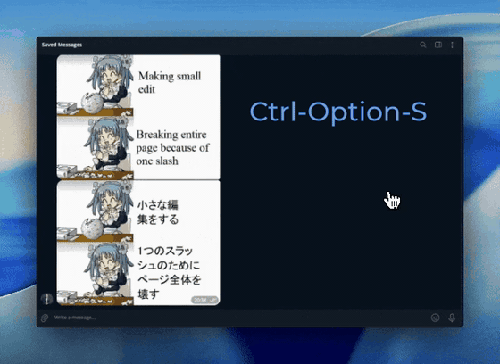
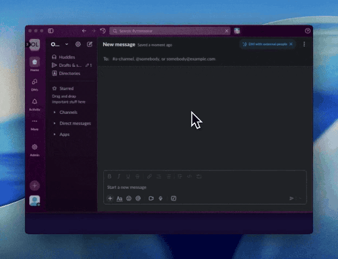

# Cliparla

**Read and reply in any language, in any Mac app.**

Drag a box over text you can't read and see the translation. Then speak in your own language, and your reply appears at the cursor in theirs.





**[Download for Mac](https://github.com/OlegTestov/cliparla/releases/latest)** · free and open source · no Cliparla account · no subscription

## Why people use it

- **Translate anything you can see.** `Ctrl + Option + S`, drag a box. It works where you can't select text: images, videos, PDFs, chat apps, game screens.
- **Speak your language, type theirs.** Hold `Ctrl + Option + V`, talk, let go. The translated text lands in Mail, Slack, WhatsApp, your browser, wherever the cursor is.
- **Or just dictate.** Choose "Keep my language" for plain voice typing. Filler words like "um" are removed, and you can turn that off.
- **Your text doesn't get lost.** If the text didn't land where you wanted, `Cmd + Ctrl + V` pastes your last result again, and your recent results stay in the menu bar. What you had copied comes back after the paste: text, rich text, images and files.
- **Your own key, no middleman.** Requests go straight from your Mac to Google with your Gemini key. Google offers free keys.

Also included: copy the text of a screen area without translating it (`Cmd + Ctrl + C`), summarize, comment on or polish a result, a personal dictionary, and your last 20 results in the menu bar. Available in 16 languages: English, Arabic, Chinese, Dutch, French, German, Hindi, Italian, Japanese, Korean, Polish, Portuguese, Russian, Spanish, Turkish and Ukrainian.

## How it compares

Most apps do one half of this: voice typing or screen translation. Cliparla puts both in one app, built for people who live or work in a language that isn't their own.

| | Translate text on screen | Speak one language, get text in another | Price |
|---|---|---|---|
| **Cliparla** | Yes | Yes, it's the main mode | Free app, your own Gemini key |
| [Wispr Flow](https://wisprflow.ai/pricing) | Not found | Not found; translation by voice command after dictating | Free 2,000 words a week, Pro from $12 a month |
| [Handy](https://github.com/cjpais/Handy) | No | English output only | Free, fully offline |
| [OpenWhispr](https://github.com/OpenWhispr/openwhispr) | Not found | Yes, a separate hotkey | Free, local models or your own key |
| [Easydict](https://github.com/tisfeng/Easydict) | Yes | No | Free |

Checked in their public docs on 3 November 2026. Tell us if something has changed.

**When another app suits you better.** Cliparla needs the internet, and your screen images and voice go to Google. If you want dictation that never leaves your Mac, try Handy.

## Get started

1. **Install.** [Download the DMG](https://github.com/OlegTestov/cliparla/releases/latest) and drag Cliparla to Applications. It is signed and notarized by Apple, so macOS only asks you to confirm the first time you open it.
2. **Paste your key.** Cliparla asks for one thing: a Gemini API key. [Get a free key from Google AI Studio](https://aistudio.google.com/app/apikey), paste it and press **Test key**.
3. **Try it.** Press `Ctrl + Option + S` and drag over some text, or hold `Ctrl + Option + V` and speak. S for screen, V for voice. Hotkeys and languages can be changed in Settings.

macOS asks for Screen Recording (screen translation), Microphone (dictation) and Accessibility (typing the dictated text, and noticing when you let go of the hotkey). Cliparla guides you through each one.

## Requirements

- A Mac with Apple silicon (M1 or newer) running macOS 13 Ventura or later. Intel Macs are not supported.
- A Google Gemini API key.
- An internet connection: every translation is a request to Google.

One dictation can last up to 3 minutes. Summarize, comment and polish take up to 50,000 characters.

If Cliparla can't paste, the new text stays on the clipboard and it tells you. Data only the source app understands, such as a spreadsheet's own cell format, may not survive a dictation.

## Bring your own Gemini key

Cliparla has no backend. Every request goes from your computer straight to Google, signed with your key.

- The key is stored encrypted with your operating system's secure storage (Electron `safeStorage`).
- Settings shows only a masked version of the key. You can replace or remove it at any time.
- If the key is missing, rejected, or out of quota, Cliparla tells you what happened and what to do.

## Privacy

Your key is stored encrypted on this computer; screen images and voice go directly to Google with your key.

- Nothing else is sent anywhere: no analytics, no crash reporting, no update check.
- Google's terms for the Gemini API differ between free and paid keys, including how content may be used. Read them if you handle sensitive material.
- Settings and the encrypted key live in Cliparla's own data folder, separate from every other app.

Details: [PRIVACY.md](PRIVACY.md).

## Build from source

```bash
npm install
npm run dev          # run the app in development
npm test             # leak gate + unit tests
npm run check        # typecheck, lint, formatting
npm run package      # unsigned app for this Mac, in ./dist
npm run release      # Developer ID signed, notarized DMG + ZIP in dist/release/<version>/ (needs your Apple Developer ID certificate and `NOTARY_PROFILE`, the name of a notarytool keychain profile; see tools/release.sh)
npm run notices      # regenerate THIRD_PARTY_NOTICES.md
npm run build:win    # Windows installer (run on Windows)
```

`npm run leak-gate` scans the project's files (tracked and not ignored) for keys, email addresses and personal paths, and runs as part of `npm test`. `npm run leak-gate:staged` checks exactly what is staged for the next commit.

### How it is put together

All AI calls go through one interface, `TranslationService` (`src/main/services/translation/`). Screenshot translation, dictation and the text actions all call it, and `GeminiTranslationService` is the only implementation. The full API key is read only inside the main process; the renderer gets a masked status.

## Feedback

Something broke, or you want a feature? Choose **Send feedback** in the menu bar, or [open an issue](https://github.com/OlegTestov/cliparla/issues/new/choose). I read all of them.

## License

Made by [Oleg Testov](https://github.com/OlegTestov). MIT, see [LICENSE](LICENSE). Third-party licenses: [THIRD_PARTY_NOTICES.md](THIRD_PARTY_NOTICES.md).
